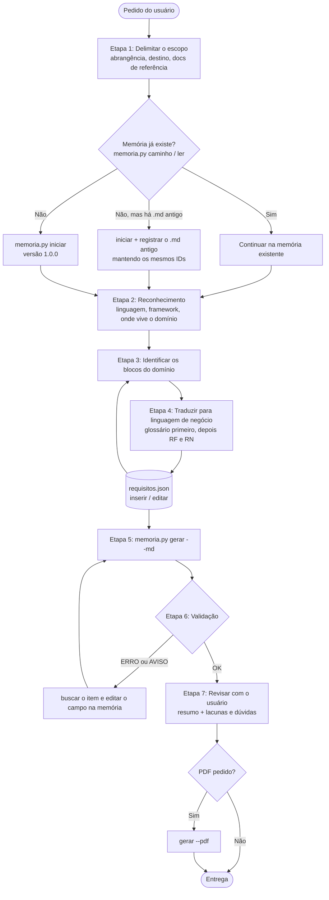
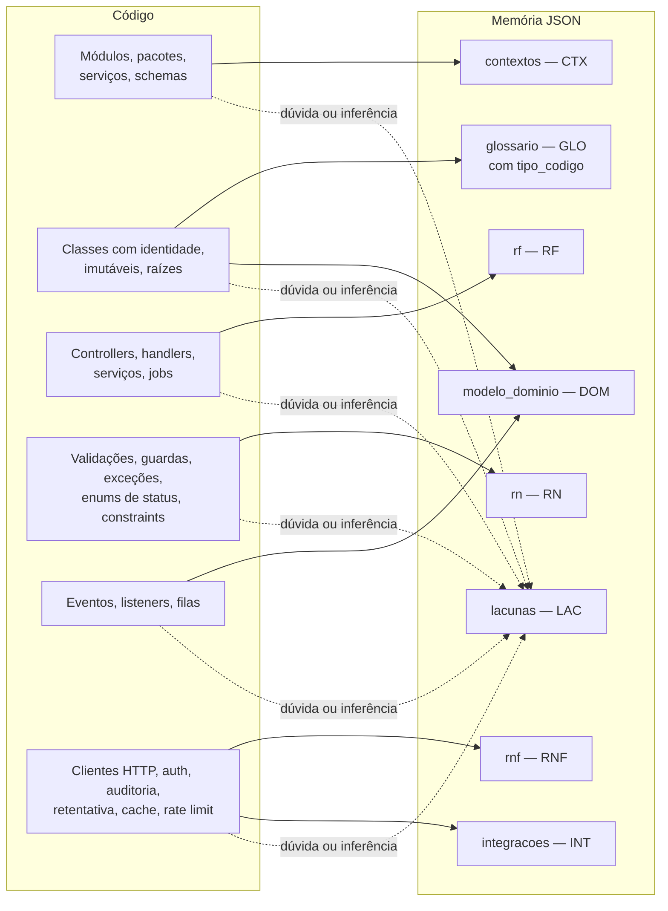
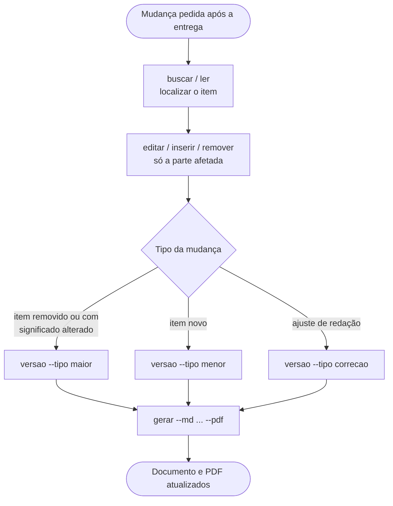

# terraform-requisitos

Skill de agente (Claude Code, OpenCode…) que faz **engenharia reversa de requisitos** a partir do código-fonte de uma aplicação existente, com foco em **DDD** (contextos delimitados, agregados, entidades, objetos de valor, eventos e regras de negócio).

O resultado é um documento de requisitos em linguagem de negócio (linguagem ubíqua), legível por quem não conhece o código, em Markdown e PDF.

- **Versão:** 1.3.0
- **Autor:** augusto

## Quando usar

Use quando o pedido for algo como:

- "levantar os requisitos" / "extrair requisitos do código"
- "documentar as regras de negócio" / "mapear o domínio"
- "criar a linguagem ubíqua" / "engenharia reversa de requisitos"
- "documento de requisitos DDD"

**Não use** para especificar uma feature que ainda não existe no código nem para documentação técnica de API.

## Princípios

| Princípio | O que significa |
|---|---|
| Nunca inventar | Tudo tem origem no código. Deduções levam "(inferido)" e entram em "Lacunas e dúvidas". |
| Linguagem de negócio | "O cliente pode cancelar um pedido", nunca "o método `cancel()` da classe `Order`". |
| Sem citar código | Nada de arquivos, pastas, linhas ou métodos. O código só aparece como tipo ("Pedido é `Order`"), no glossário e na rastreabilidade. |
| Glossário primeiro | A linguagem ubíqua é montada antes dos requisitos, e um conceito tem sempre o mesmo termo. |
| Memória JSON é a fonte da verdade | Todo achado vai para `~/.terraforme/<projeto>/requisitos.json`. O `.md` e o PDF são sempre gerados dela. |
| Versionamento | Todo documento tem "Controle de versões". IDs (RF, RN, RNF) nunca são renumerados nem reaproveitados. |

## Estrutura da pasta

```
terraform-requisitos/
├── SKILL.md                          # instruções da skill (lidas pelo agente)
├── README.md                         # este arquivo
├── scripts/
│   ├── memoria.py                    # CLI da memória JSON e gerador do .md
│   ├── validar_documento.py          # validador do documento .md
│   ├── gerar_pdf.py                  # PDF
│   └── tests/test_memoria.py         # testes da memória
├── references/
│   ├── esquema-json.md               # campos e comandos da memória
│   ├── modelo-documento.md           # estrutura do documento gerado
│   └── traducao-codigo-negocio.md    # padrões de código → frases de negócio
└── exemplo/
    ├── requisitos.json               # memória de exemplo preenchida
    ├── exemplo-documento.md          # documento gerado dela
    └── exemplo-documento.pdf         # PDF
```

## Fluxograma geral



## Etapa 3 em detalhe: o que procurar e onde registrar



A ordem de busca é a mesma da numeração: contextos → agregados/entidades/objetos de valor → ações → regras → eventos → integrações e requisitos não funcionais.

## Fluxo de atualização (Etapa 6b)



Ao remover, registre a versão **antes** do `remover`: RF, RN e RNF removidos continuam no documento com "(removido na versão X.Y.Z)".

## Comandos da memória

```bash
# Localiza a pasta da skill instalada, em qualquer agente:
SKILL="$(for d in "$HOME/.claude/skills/terraform-requisitos" \
  "$HOME/.config/opencode/skills/terraform-requisitos" "$HOME/.agents/skills/terraform-requisitos" \
  ".claude/skills/terraform-requisitos" ".opencode/skills/terraform-requisitos"; do
  [ -f "$d/SKILL.md" ] && printf '%s' "$d" && break
done)"
M="python3 \"$SKILL/scripts/memoria.py\""

$M iniciar   <projeto> --titulo "<Nome>" --autor "<autor>"   # cria a memória na versão 1.0.0
$M caminho   <projeto>                                        # mostra onde está a memória
$M inserir   <projeto> <secao> --json '{...}'                 # achado novo; imprime o id criado
$M editar    <projeto> <secao> <id> --campo <c> --valor <v> [--anexar]
$M remover   <projeto> <secao> <id>
$M ler       <projeto> [<secao> [<id>]] [--campo <c>]
$M buscar    <projeto> "<texto>" [--secao <secao>]
$M verificar <projeto>                                        # ligações quebradas antes de gerar
$M versao    <projeto> --tipo maior|menor|correcao --mudancas "<texto>"
$M gerar     <projeto> [--md <caminho.md>] [--pdf]
```

Seções: `documento`, `visao_geral`, `contextos`, `glossario`, `modelo_dominio`, `rf`, `rn`, `rnf`, `integracoes`, `lacunas`. A raiz `~/.terraforme` (`%APPDATA%\.terraforme` no Windows) pode ser trocada pela variável `TERRAFORME_HOME`. Detalhes de cada campo em `references/esquema-json.md`.

## Validação

O `gerar` recusa a memória enquanto houver ligação quebrada (RN citada que não existe, termo da rastreabilidade fora do glossário ou sem tipo). Depois de escrever o `.md`, ele roda o validador, que confere:

- seções obrigatórias e controle de versões (formato, ordem, igual à "Versão do documento");
- IDs duplicados ou citados sem definição;
- critérios de aceite no formato Dado/Quando/Então;
- rastreabilidade no formato "Termo é `Tipo`", com termo no glossário e mesmo tipo;
- referências a arquivos, pastas, métodos ou caminhos de código (erro) e termos de código vazando para o texto (aviso).

Para validar um `.md` avulso:

```bash
python3 "$SKILL/scripts/validar_documento.py" <documento.md>
```

## Geração de PDF

```bash
$M gerar <projeto> --md docs/requisitos.md --pdf

# avulso, a partir de um .md
uv run scripts/gerar_pdf.py <documento.md> [-o saida.pdf] [--sem-sumario]
```

Dependências: `reportlab` e `markdown-it-py` (instaladas pelo `uv run`; sem `uv`, use `pip install`). O PDF tem sumário clicável, versão no cabeçalho e "Página X de Y".

## Estrutura do documento gerado

Controle de versões · Visão geral · Contextos delimitados · Glossário (linguagem ubíqua) · Modelo de domínio (agregados, entidades, objetos de valor, ciclo de vida, eventos) · Requisitos funcionais com critérios de aceite · Regras de negócio · Requisitos não funcionais · Integrações externas · Rastreabilidade · Lacunas e dúvidas.

Seções sem conteúdo saem como "Não identificado". Veja `exemplo/exemplo-documento.md` para o tom e o nível de detalhe esperados.

## Solução de problemas

| Sintoma | Causa | Solução |
|---|---|---|
| `gerar` recusa a memória | Ligação quebrada (RN inexistente, termo fora do glossário ou sem `tipo_codigo`) | `verificar`, inserir o que falta e gerar de novo |
| `inserir` recusa o item | Campo desconhecido/obrigatório vazio, item repetido, `tipo_codigo` inválido | Conferir `references/esquema-json.md`; se já existe, use `editar` |
| Código não segue DDD (MVC, CRUD) | Domínio espalhado em controllers, models e SQL | Tratar grupos de tabelas/telas como contextos candidatos e registrar a inferência em lacunas |
| Muitos termos de código no texto | Frases descrevem implementação | Trocar identificadores por termos do glossário |
| Referência a arquivo de código | Caminho entrou no documento | Remover; usar o tipo na rastreabilidade ou citar documentação |
| Nomes genéricos (Manager, Helper) | Código não usa linguagem de negócio | Propor termo "(inferido)" e levar a dúvida ao usuário |

## Skills relacionadas

- **terraforme-doc-validator**: valida o documento gerado sob a ótica de cinco personas (Stakeholder, PO, PM, Dev, Tester).
